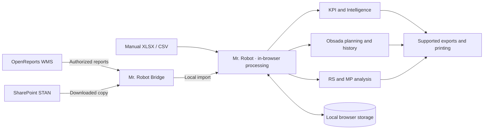

<div align="center">
  

  # Mr. Robot
  ### Warehouse Operations Workspace

  **Better decisions from the data you already have.**  
  An installable, local-first application for warehouse analytics, staffing, inventory workflows and reporting.

  [**Launch application**](https://horkiroman4408-cyber.github.io/Mr.-Robot-App/) · [Explore modules](#the-workspace) · [Install](#installation)

  **English** · [Polski](./README.pl.md) · [Русский](./README.ru.md)

       
     
</div>

---

> [!NOTE]
> **Built for real warehouse workflows.** Mr. Robot does not require a central application account. Excel processing runs in the browser. OpenReports and SharePoint integrations are optional and work only with the access and permissions you already have.

## A workspace, not another spreadsheet

Warehouse work rarely lives in one report. Performance comes from KPI workbooks, staffing from shift plans, stock details from WMS exports, and operational decisions from comparing them. Mr. Robot brings these tasks into one interface without forcing them into a single source of truth.

| **Analyze** | **Plan** | **Verify** | **Automate** |
|:---|:---|:---|:---|
| KPI, norms, employee results | Hourly assignments, teams, shift history | Totes, locations, stock events, audits | Repeatable reports, local exports, optional Bridge |

**A typical workflow:** open a module → import a permitted workbook or refresh a supported report → filter the results → inspect employee/process details → export or print the outcome. Saved local files and preferences help avoid repeating the same setup every day.

### The essentials

- **Five functional areas:** KPI, Obsada, RS, MP and Inne, plus shared employee information and Mr. Bot intelligence features.
- **Local-first:** workbook calculations and local planning data stay in your browser unless you explicitly export or connect a permitted integration.
- **PWA:** install on desktop or phone; cached tools and saved local data can work without a network connection.
- **Four interface languages:** Polish, Russian, English and Ukrainian, with multiple visual themes.
- **Operationally useful output:** XLSX/CSV exports, copy-ready tables, A4 printing and PDF printing where supported.

## The workspace

### 01 / KPI · Performance & people

Analyze employee productivity without manually rebuilding Excel formulas for each report. Process-specific views retain their own calculation rules and norm thresholds.

| Tool | What it provides |
|:---|:---|
| **Audyt** | KPI and INFO analysis of audit activity |
| **Scalanie / Pick** | Process results, norms and employee comparisons |
| **Rozkładanie** | Storage performance and process-specific classifications |
| **NADWE / VAS** | Quantity, time in hours and items per hour, presented separately for both processes |
| **Statistics** | Overall comparisons, rankings and summary measures |
| **Pracownicy** | Employee directory, training registry, profile and schedule information from imported files |

Depending on the view, you can filter groups, shifts and dates, adjust saved norms, open linked employee profiles and export or print reports. **Mr. Bot / Intelligence** explains supported figures and rules inside the application.

### 02 / Obsada · Workforce planning

**Obsada is a complete operational workflow, not just a staffing table.** It separates the latest downloaded **STAN** source from the locally maintained planning database. This distinction matters: editing a local assignment does not modify the SharePoint workbook.

| Workspace | Purpose |
|:---|:---|
| **Rozstawienie** | View assignments for a selected date and hour, including overlapping teams |
| **Planowanie** | Assign people to processes hour by hour; manage teams, shifts, late arrivals and early departures |
| **Plan na jutro** | Prepare a next-day roster with team and absence sections; export to Excel or print |
| **Historia** | Review local and imported records and inspect discrepancies |
| **Intelligence** | Compare working hours and days across employees, teams and selected processes |

**Planning in practice**

- Shifts can overlap and cross midnight; employees may move between processes during the same shift.
- Saved teams and functional roles are managed separately from individual hourly assignments.
- Past hours can be corrected in the local plan. Completed hours are taken into account by the history logic.
- Tomorrow's plan respects selected employees and processes, with separate sections for each chosen team and for `WOLNY` / `URLOP` when included.

**Intelligence in practice**

Choose a **week, month or custom date range**, then select employees or saved teams. Filter by **one or several processes**: cards show only those processes, add their hours and count a day worked on two selected processes only once. **Ostatnia / Poprzednia** instead show the last two completed workdays across *all* processes, independently of the analysis filter. Absence-day indicators remain separate.

**Exchange local databases safely**

The **Przekaż koledze / Odbierz od kolegi** workflow exchanges XLSX files between colleagues. A preview identifies new entries and conflicts. Keep your local record, choose your colleague's record per conflict, or apply **Dane kolegi dla wszystkich** and then adjust individual choices. Before a merge, the app attempts to preserve a local backup and the received file in `Backup` and `Import`. This requires access to the configured folder; if access is lost, reconnect it before merging. Review any discrepancies between imported history and local assignments.

> [!IMPORTANT]
> The local database, exported XLSX files and the SharePoint source are **not interchangeable**. Keep backups before significant merges. Imported online files are copies, not live updates to the original workbook.

### 03 / RS · Totes, SKU and audits

Turn large MP/RS datasets into actionable stock locations and audit results.

- **Tote Finder:** match MP/RS records by supported SKU/EAN and shelf information to locate matching totes and quantities.
- **AUDYT GEEK / RET:** analyze stocktake records, exceptions and grouped audit results.
- **Scalanie Geek:** group SKU records and identify totes with small quantities using adjustable thresholds.
- **Operational outputs:** filters, selectable results, clipboard-ready tables and supported XLSX exports.

### 04 / MP · Location operations

Work with the location data behind audits, closures and inventory checks.

| Tool | Focus |
|:---|:---|
| **AL_AUDYT** | Audit results and INFO classification |
| **FORMATKA_59** | Dedicated quality-check workflow |
| **GODZINY_MDT** | Time-based MDT and location analysis |
| **STOCK** | Shelf closures by selected hours, operators and repeated events |
| **Scalanie** | Location selection and result exports |
| **Konsolidacja** | Identification of candidate locations for consolidation |

Location filters cover relevant `MP1 / MP2 / MP3` cases where supported. Some tools deliberately use different rules: **FORMATKA_59**, for example, has its own MP2-specific treatment. The application does not apply one blanket rule to every report.

### 05 / Inne · Everyday utilities

| Tool | Purpose |
|:---|:---|
| **Analiza przestojów** | Investigate qualifying downtime intervals and related employee records |
| **ARTLTT** | Produce operational LTT CSV files from product names |
| **Kreseczki** | Generate and print Code 128 barcodes locally |

## Mr. Bot · The in-app assistant

Mr. Bot is Mr. Robot's **built-in, animated assistant**, not a separate web service. It offers contextual guidance around supported app functions, warehouse terminology and report interpretation, with an offline dialogue and documentation library available in **PL, RU, EN and UK**.

| Part | What it does |
|:---|:---|
| **Ask Mr. Bot** | Answer supported questions about navigating modules, importing reports, filters and common workflows |
| **Knowledge & guides** | Explain documented calculations, processes and where to find tools in the app |
| **Animated companion** | React to actions such as loading, processing, completing, copying and errors with visual states |
| **Intelligence features** | Provide contextual explanations alongside supported KPI, RS, MP and STOCK views; Obsada Intelligence separately summarizes recorded staff history |

> [!NOTE]
> Mr. Bot's offline answers use predefined knowledge and dialogue rules. It is **not a cloud AI chatbot**, does not independently browse corporate systems, and should not be treated as a source of new report figures without loaded data.

## Integrations · Mr. Robot Bridge

Bridge is an **optional Edge / Chrome browser extension**, currently **v0.3.29** in this repository. It connects two distinct workflows:

| Connection | What happens | What it does **not** do |
|:---|:---|:---|
| **OpenReports** | Requests supported WMS reports and downloads XLSX files for local processing | Bypass WMS access, store a login password or replace module calculations |
| **SharePoint** | Refreshes an authorized Excel copy used by Obsada | Edit the online workbook or continuously synchronize it in the background |



**How to read the diagram:** It describes possible data paths, not an automatic live synchronization. Exports depend on the module.

**Set up the extension**

1. Download the [Bridge v0.3.29 archive](./downloads/OpenReports-Bridge-v0.3.29.zip) and extract it.
2. Open `edge://extensions` or `chrome://extensions`, enable **Developer mode** and choose **Load unpacked**. Select the extracted extension folder containing `manifest.json`.
3. In Mr. Robot, open **Ustawienia → Bridge** and configure access and download folders.
4. For the SharePoint source, use the settings control by **Obsada → Grafik procesowy**. The source configuration opens on demand, not automatically when the connection is absent.

**Source:** [extension/openreports-bridge/](./extension/openreports-bridge/) · **Version:** `0.3.29` · **Note:** unpacked extensions are updated manually; organizational browser policies may restrict installation.

## Installation

**[Open the live application](https://horkiroman4408-cyber.github.io/Mr.-Robot-App/)**, or install it as a PWA:

| Platform | Installation |
|:---|:---|
| **Windows / macOS** | Edge / Chrome → browser's **Install app** action |
| **Android** | Chrome menu → **Install app** (where available) |
| **iPhone** | Safari → **Share** → **Add to Home Screen** |

The first visit requires an internet connection to cache the app. Previously cached local features may then run offline. **Fresh WMS/SharePoint data and app updates still require network access.** Browser storage is not a substitute for a backed-up XLSX file.

## Architecture · Local-first by design

The application combines **Vue 3**, browser-based XLSX processing with **SheetJS**, module-specific **Web Workers**, persistent **IndexedDB** data and an installable **Service Worker** shell. Bridge remains separate from the local calculations.

```text
Mr.-Robot-App/
├── index.html                         Vue application shell
├── css/                               App and module styles
├── js/
│   ├── app.js                         Main application state
│   ├── obsada-planner.js              Staff plans, local base, XLSX export
│   ├── obsada-team-intelligence.js    Hour and workday summaries
│   ├── obsada-merge.js                Database merge rules
│   ├── obsada-unified-history.js      Reconciled history
│   ├── changelog.js                   In-app "What's New"
│   └── workers/                       Report-processing workers
├── extension/openreports-bridge/      Optional browser extension
├── downloads/                         Release archives
├── tests/                             Project tests
├── manifest.webmanifest               PWA metadata
└── sw.js                              Caching and updates
```


## Data, privacy & operational boundaries

- Workbook analysis runs in the browser. Files you choose to export or connect to permitted systems follow those explicit actions.
- Local data may persist in IndexedDB and an authorized local folder. Clearing browser storage or losing folder access may affect availability; keep your own backups.
- Bridge actions require access to the underlying systems. Mr. Robot does not grant additional permissions.
- Use anonymized samples in public bug reports. Do **not** upload real employee records or confidential company reports to public issues.
- The tool supports operational work; it is not the authoritative WMS, HR or payroll system.

## Project, credits & rights

Created and maintained by **Raman Horki**. Contributions, feedback and reproducible bug reports are welcome through [GitHub Issues](https://github.com/horkiroman4408-cyber/Mr.-Robot-App/issues).

**License:** [Mr. Robot Personal & Workplace Use License](./LICENSE) ([Polski](./LICENSE.pl.md) · [Русский](./LICENSE.ru.md) · [Українська](./LICENSE.uk.md)). The official application may be used free of charge for personal and internal workplace tasks, including in other organizations. Modification of the original source code, including for private or internal use, is not permitted without separate authorization, except as independently allowed by law or third-party licenses. Publishing, selling or distributing other versions also requires separate rights or permission. This is **not an open-source license**. [Third-party notices](./THIRD_PARTY_NOTICES.md) continue to apply, and the grant only covers materials the licensor is entitled to license.

---
<div align="center">
  <sub>© 2026 Raman Horki</sub>
</div>
