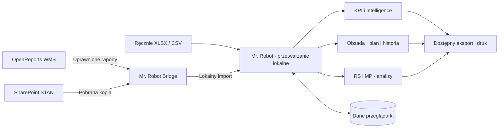

<div align="center">
  

  # Mr. Robot
  ### Centrum Operacji Magazynowych

  **Lepsze decyzje dzięki danym, które już masz.**  
  Instalowalna aplikacja local-first do analityki magazynowej, planowania obsady, pracy z lokalizacjami i raportowania.

  [**Uruchom aplikację**](https://horkiroman4408-cyber.github.io/Mr.-Robot-App/) · [Poznaj moduły](#moduły) · [Instalacja](#instalacja)

  [English](./README.md) · **Polski** · [Русский](./README.ru.md)

       
     
</div>

---

> [!NOTE]
> **Stworzony do rzeczywistych procesów magazynowych.** Mr. Robot nie wymaga centralnego konta aplikacji. Pliki Excel są analizowane w przeglądarce. Integracje OpenReports i SharePoint są opcjonalne i działają wyłącznie w ramach posiadanych uprawnień.

## Jedno środowisko zamiast kolejnego arkusza

Dane magazynowe rzadko znajdują się w jednym raporcie. Wydajność wynika z plików KPI, obsada z planów zmian, stany z raportów WMS, a decyzje z porównania tych źródeł. Mr. Robot łączy te zadania w jednym interfejsie, nie udając, że wszystkie dane pochodzą z jednego systemu.

| **Analizuj** | **Planuj** | **Weryfikuj** | **Automatyzuj** |
|:---|:---|:---|:---|
| KPI, normy, wyniki pracowników | Przydziały godzinowe, zespoły, historia | Tote, lokalizacje, zdarzenia STOCK, audyty | Powtarzalne raporty, eksporty, opcjonalny Bridge |

**Typowy scenariusz:** otwórz moduł → wczytaj uprawniony plik lub pobierz obsługiwany raport → wybierz filtry → sprawdź wyniki procesu i pracowników → wyeksportuj lub wydrukuj rezultat. Zapamiętane pliki i ustawienia ograniczają codzienne powtarzanie tych samych czynności.

### Najważniejsze możliwości

- **Pięć obszarów:** KPI, Obsada, RS, MP i Inne, a także wspólne informacje o pracownikach i funkcje Mr. Bot Intelligence.
- **Local-first:** obliczenia Excel i lokalna baza obsady działają w przeglądarce; transfer następuje przy świadomym eksporcie lub użyciu integracji.
- **PWA:** instalacja na komputerze i telefonie; zapamiętane dane i zasoby aplikacji mogą działać offline.
- **Cztery języki:** polski, rosyjski, angielski i ukraiński oraz kilka motywów wizualnych.
- **Praktyczne wyniki:** eksport XLSX/CSV, tabele do kopiowania, druk A4 i druk do PDF w odpowiednich widokach.

## Moduły

### 01 / KPI · Wydajność i pracownicy

Analiza wydajności bez codziennego odtwarzania formuł w Excelu. Poszczególne procesy zachowują własne reguły obliczeń i progi norm.

| Narzędzie | Zastosowanie |
|:---|:---|
| **Audyt** | Wskaźniki KPI i analiza INFO dla audytów |
| **Scalanie / Pick** | Wyniki procesowe, normy i porównania pracowników |
| **Rozkładanie** | Wydajność rozkładania i klasyfikacje procesowe |
| **NADWE / VAS** | Liczba sztuk, czas w godzinach i sztuki na godzinę osobno dla obu procesów |
| **Statistics** | Zestawienia ogólne, rankingi i miary podsumowujące |
| **Pracownicy** | Baza pracowników, rejestr szkoleń, profil i grafik z wczytanych plików |

W zależności od widoku można filtrować grupy, zmiany i daty, zapamiętywać normy, otwierać profile pracowników oraz eksportować lub drukować wyniki. **Mr. Bot / Intelligence** objaśnia obsługiwane wskaźniki i reguły bezpośrednio w aplikacji.

### 02 / Obsada · Planowanie ludzi i procesów

**Obsada to cały proces operacyjny, a nie tylko tabela pracowników.** Rozdziela aktualną pobraną kopię źródła **STAN** od lokalnej bazy planowania. Zmiana lokalnego przydziału nie modyfikuje pliku na SharePoint.

| Widok | Do czego służy |
|:---|:---|
| **Rozstawienie** | Podgląd przydziałów dla wybranej daty i godziny, również przy nakładających się zespołach |
| **Planowanie** | Przydziały godzinowe, zespoły, grafiki, spóźnienia i wcześniejsze wyjścia |
| **Plan na jutro** | Lista na kolejny dzień z podziałem na zespoły i nieobecności; Excel oraz druk |
| **Historia** | Podgląd zapisów lokalnych i importowanych oraz rozbieżności |
| **Intelligence** | Porównywanie godzin i dni pracy między pracownikami, zespołami i procesami |

**Planowanie w praktyce**

- Zmiany mogą zachodzić na siebie i przechodzić przez północ. Pracownik może zmieniać proces w trakcie zmiany.
- Zapisane zespoły i osoby funkcyjne są zarządzane niezależnie od poszczególnych przydziałów godzinowych.
- W lokalnym planie można korygować godziny, które już minęły; historia uwzględnia zakończone okresy pracy.
- Plan na jutro respektuje wybranych pracowników i procesy. Zawiera osobne sekcje dla wybranych zespołów oraz `WOLNY` / `URLOP`, jeśli je uwzględniono.

**Intelligence w praktyce**

Wybierz **tydzień, miesiąc lub własny zakres dat**, a potem pracowników lub zapisane zespoły. Możesz filtrować **jeden lub kilka procesów**: karty pokazują tylko wybrane procesy, sumują ich godziny i liczą dzień pracy na dwóch procesach tylko raz. **Ostatnia / Poprzednia** pokazują natomiast dwa ostatnie zakończone dni pracy ze *wszystkimi* procesami, niezależnie od filtra analizy. Statusy nieobecności pozostają osobnymi wskaźnikami.

**Bezpieczna wymiana baz lokalnych**

Funkcje **Przekaż koledze / Odbierz od kolegi** służą do wymiany plików XLSX. Podgląd wskazuje nowe wpisy i konflikty. Możesz zachować własny wpis, wybrać wpis kolegi osobno lub użyć **Dane kolegi dla wszystkich** i poprawić pojedyncze decyzje. Przed scaleniem aplikacja próbuje zapisać kopię bieżącej bazy i odebranego pliku w folderach `Backup` oraz `Import`. Wymagany jest dostęp do skonfigurowanego katalogu. W razie utraty uprawnień połącz katalog ponownie. Sprawdzaj rozbieżności między historią importowaną a planem lokalnym.

> [!IMPORTANT]
> Baza lokalna, eksportowane pliki XLSX i źródło SharePoint **nie są tym samym źródłem danych**. Zachowuj kopie zapasowe przed ważnymi scaleniami. Pobierany plik online jest kopią, a nie edycją oryginału na żywo.

### 03 / RS · Tote, SKU i audyty

Przekształcaj duże bazy MP/RS w użyteczne listy lokalizacji i wyniki kontroli.

- **Tote Finder:** dopasowanie MP/RS według obsługiwanych danych SKU/EAN i lokalizacji, wyszukiwanie tote oraz ilości.
- **AUDYT GEEK / RET:** analiza wierszy Stocktake, wyjątków i wyników audytu według kategorii.
- **Scalanie Geek:** grupowanie SKU i identyfikacja tote z małą ilością sztuk przy ustawianych progach.
- **Wyniki operacyjne:** filtry, zaznaczanie rekordów, tabele do kopiowania oraz dostępne eksporty XLSX.

### 04 / MP · Lokalizacje i stany

Narzędzia do kontroli lokalizacji, zamknięć półek i procesów magazynowych.

| Narzędzie | Zakres |
|:---|:---|
| **AL_AUDYT** | Wyniki audytu i klasyfikacja INFO |
| **FORMATKA_59** | Osobny proces kontroli jakości |
| **GODZINY_MDT** | Analiza MDT i lokalizacji według godzin |
| **STOCK** | Zamknięcia półek, wybrane godziny, operatorzy i powtórzenia |
| **Scalanie** | Wybór lokalizacji i eksport wyników |
| **Konsolidacja** | Wyszukiwanie lokalizacji do potencjalnej konsolidacji |

Filtry obejmują odpowiednie `MP1 / MP2 / MP3`, zależnie od narzędzia. Nie wszystkie moduły stosują te same zasady: np. **FORMATKA_59** ma własną logikę dotyczącą MP2. Aplikacja nie narzuca jednej reguły na wszystkie raporty.

### 05 / Inne · Narzędzia codzienne

| Narzędzie | Zastosowanie |
|:---|:---|
| **Analiza przestojów** | Analiza kwalifikujących się przerw i danych pracowników |
| **ARTLTT** | Przygotowanie plików LTT CSV z nazw artykułów |
| **Kreseczki** | Lokalny generator i druk kodów kreskowych Code 128 |

## Mr. Bot · Asystent aplikacji

Mr. Bot to **wbudowany, animowany asystent** Mr. Robot, a nie oddzielna usługa internetowa. Pomaga korzystać z funkcji aplikacji, objaśnia pojęcia magazynowe i zasady raportów, korzystając z lokalnych dialogów i dokumentacji w językach **PL, RU, EN i UK**.

| Element | Działanie |
|:---|:---|
| **Zapytaj Mr. Bota** | Odpowiedzi na obsługiwane pytania o moduły, import raportów, filtry i codzienną pracę |
| **Baza wiedzy i instrukcje** | Objaśnienia udokumentowanych obliczeń, procesów i sposobu korzystania z narzędzi |
| **Animowany asystent** | Reakcje wizualne na ładowanie, przetwarzanie, sukces, kopiowanie czy błędy |
| **Funkcje Intelligence** | Kontekstowe objaśnienia w obsługiwanych widokach KPI, RS, MP i STOCK; Obsada Intelligence osobno podsumowuje historię pracy |

> [!NOTE]
> Odpowiedzi Mr. Bota offline opierają się na przygotowanej wiedzy i regułach dialogu. **Nie jest to chatbot AI działający w chmurze**, nie przegląda samodzielnie systemów firmowych i nie tworzy nowych wyników bez wczytanych danych.

## Integracje · Mr. Robot Bridge

Bridge to **opcjonalne rozszerzenie Edge / Chrome**, aktualnie w wersji **0.3.29** w tym repozytorium. Obsługuje dwa niezależne połączenia:

| Połączenie | Co robi | Czego **nie** robi |
|:---|:---|:---|
| **OpenReports** | Uruchamia obsługiwane raporty WMS i pobiera XLSX do lokalnej analizy | Nie omija uprawnień WMS, nie przechowuje hasła i nie zastępuje obliczeń modułów |
| **SharePoint** | Ręcznie odświeża uprawnioną kopię Excela dla Obsada | Nie edytuje oryginalnego skoroszytu ani nie synchronizuje go stale w tle |



**Jak czytać schemat:** Przedstawia możliwe ścieżki danych, nie automatyczną synchronizację na żywo. Formaty eksportu zależą od modułu.

**Konfiguracja rozszerzenia**

1. Pobierz [archiwum Bridge v0.3.29](./downloads/OpenReports-Bridge-v0.3.29.zip) i rozpakuj je.
2. Otwórz `edge://extensions` lub `chrome://extensions`, włącz **Tryb dewelopera**, wybierz **Załaduj rozpakowane** i wskaż folder zawierający `manifest.json`.
3. W Mr. Robot przejdź do **Ustawienia → Bridge** i skonfiguruj dostęp oraz foldery pobierania.
4. Źródło SharePoint ustawisz przyciskiem konfiguracji obok **Obsada → Grafik procesowy**. Formularz otwiera się na żądanie, a nie automatycznie przy braku połączenia.

**Kod rozszerzenia:** [extension/openreports-bridge/](./extension/openreports-bridge/) · **Wersja:** `0.3.29` · **Uwaga:** rozpakowane rozszerzenie aktualizuje się ręcznie, a polityka firmowa może ograniczać jego instalację.

## Instalacja

**[Otwórz działającą aplikację](https://horkiroman4408-cyber.github.io/Mr.-Robot-App/)** lub zainstaluj ją jako PWA:

| Platforma | Instalacja |
|:---|:---|
| **Windows / macOS** | Edge / Chrome → opcja **Zainstaluj aplikację** |
| **Android** | Menu Chrome → **Zainstaluj aplikację** (jeśli dostępne) |
| **iPhone** | Safari → **Udostępnij** → **Do ekranu początkowego** |

Pierwsze otwarcie wymaga internetu do zapisania zasobów PWA. Następnie wcześniej zapisane narzędzia i dane lokalne mogą działać offline. **Nowe raporty WMS/SharePoint oraz aktualizacje nadal wymagają sieci.** Dane w przeglądarce nie zastępują bezpiecznej kopii pliku XLSX.

## Architektura · Local-first

Mr. Robot łączy **Vue 3**, analizę XLSX przez **SheetJS**, procesy **Web Workers**, trwałą pamięć **IndexedDB** i instalowalną powłokę **Service Worker**. Bridge pozostaje niezależny od obliczeń lokalnych.

```text
Mr.-Robot-App/
├── index.html                         Interfejs Vue
├── css/                               Style aplikacji i modułów
├── js/
│   ├── app.js                         Główny stan aplikacji
│   ├── obsada-planner.js              Obsada, baza lokalna, eksport XLSX
│   ├── obsada-team-intelligence.js    Podsumowania godzin i dni pracy
│   ├── obsada-merge.js                Reguły scalania baz
│   ├── obsada-unified-history.js      Historia po uzgodnieniu źródeł
│   ├── changelog.js                   „Co nowego”
│   └── workers/                       Obsługa raportów w tle
├── extension/openreports-bridge/      Opcjonalne rozszerzenie
├── downloads/                         Archiwa wydań
├── tests/                             Testy projektu
├── manifest.webmanifest               Metadane PWA
└── sw.js                              Pamięć offline i aktualizacje
```


## Dane, prywatność i ograniczenia

- Pliki Excel są analizowane w przeglądarce. Eksport lub połączenie z uprawnionym systemem następuje w wyniku wybranego działania.
- Dane lokalne mogą być zapisane w IndexedDB i uprawnionym folderze. Wyczyszczenie pamięci przeglądarki lub utrata dostępu może ograniczyć ich dostępność; wykonuj kopie zapasowe.
- Bridge wymaga uprawnień do systemów źródłowych. Mr. Robot nie nadaje dodatkowego dostępu.
- Do publicznych zgłoszeń dodawaj wyłącznie zanonimizowane przykłady. **Nie publikuj** rzeczywistych danych pracowników ani poufnych raportów firmy.
- Aplikacja wspiera pracę operacyjną, ale nie zastępuje oficjalnych systemów WMS, HR ani rozliczeń płacowych.

## Projekt, autor i prawa

Autorem projektu jest **Raman Horki**. Pomysły, informacje zwrotne i odtwarzalne zgłoszenia błędów można przekazywać przez [GitHub Issues](https://github.com/horkiroman4408-cyber/Mr.-Robot-App/issues).

**Licencja:** w repozytorium nie opublikowano obecnie głównej licencji projektu. Publiczna dostępność kodu nie oznacza automatycznej zgody na jego kopiowanie, rozpowszechnianie czy komercyjne wykorzystanie. Komponenty firm trzecich zachowują własne informacje licencyjne. W razie potrzeby uzyskaj zgodę autora.

---
<div align="center">
  <sub>© 2026 Raman Horki</sub>
</div>
