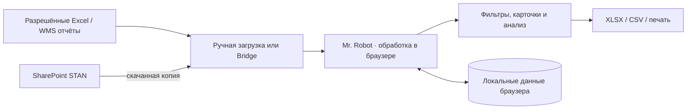

<div align="center">
  

  # Mr. Robot
  ### Рабочая платформа для складских операций

  **Превращайте уже имеющиеся данные в понятные рабочие решения.**  
  Устанавливаемое local-first приложение для аналитики склада, планирования сотрудников, работы с локациями и отчётности.

  [**Открыть приложение**](https://horkiroman4408-cyber.github.io/Mr.-Robot-App/) · [Модули](#модули) · [Установка](#установка) · [Для разработчиков](./DEVELOPMENT.md)

  [English](./README.md) · [Polski](./README.pl.md) · **Русский**

     
</div>

---

> [!NOTE]
> **Создан для реальных складских процессов.** Mr. Robot не требует центральной учётной записи приложения. Excel обрабатывается в браузере. Интеграции OpenReports и SharePoint необязательны и работают только с тем доступом, который уже есть у пользователя.

## Одна рабочая среда вместо очередной таблицы

Складские задачи редко укладываются в один отчёт. Производительность находится в KPI-файлах, расстановка людей — в графиках смен, данные полок — в выгрузках WMS. Чтобы принять решение, приходится сопоставлять разные источники. Mr. Robot объединяет эти задачи в одном интерфейсе, не притворяясь, что у них одна общая база.

| **Анализ** | **Планирование** | **Проверка** | **Автоматизация** |
|:---|:---|:---|:---|
| KPI, нормы, показатели сотрудников | Назначения по часам, команды, история смен | Tote, локации, STOCK, аудиты | Повторяемые отчёты, экспорт, Bridge |

**Обычный рабочий сценарий:** открыть модуль → загрузить разрешённый Excel или получить поддерживаемый отчёт → настроить фильтры → проверить сотрудников и процессы → экспортировать или распечатать результат. Сохранённые локальные файлы и настройки позволяют не повторять одни и те же действия каждый день.

### Главное о платформе

- **Пять направлений:** KPI, Obsada, RS, MP и Inne, а также общие данные о сотрудниках и функции Mr. Bot Intelligence.
- **Local-first:** обработка Excel и локальная база Obsada работают в браузере; обмен данными происходит при явном экспорте или использовании подключённой интеграции.
- **PWA:** установка на компьютер и телефон; ранее сохранённые данные и закэшированные функции могут работать без интернета.
- **Четыре языка:** польский, русский, английский и украинский, плюс несколько тем оформления.
- **Практические результаты:** XLSX/CSV, таблицы для копирования, печать A4 и печать в PDF в поддерживаемых инструментах.

## Модули

### 01 / KPI · Производительность и сотрудники

Анализ эффективности без ежедневной ручной пересборки формул в Excel. Каждый процесс сохраняет собственные правила вычислений и пороги норм.

| Инструмент | Возможности |
|:---|:---|
| **Audyt** | KPI и анализ INFO для аудитов |
| **Scalanie / Pick** | Результаты процессов, нормы, сравнение сотрудников |
| **Rozkładanie** | Производительность раскладки и классификация операций |
| **NADWE / VAS** | Количество, время в часах и штук в час по каждому процессу |
| **Statistics** | Общие показатели, рейтинги и сводные метрики |
| **Pracownicy** | База сотрудников, реестр обучения, профили и графики из импортированных файлов |

В зависимости от раздела доступны фильтры групп, смен и дат, сохранение настроек норм, переходы в карточки сотрудников, экспорт и печать. **Mr. Bot / Intelligence** объясняет поддерживаемые показатели и правила прямо внутри приложения.

### 02 / Obsada · Планирование сотрудников

**Obsada — полноценный рабочий процесс, а не таблица с логинами.** Здесь разделяются актуальная скачанная копия **STAN** и **локальная база планирования**. Исправление назначения в локальной базе не изменяет исходный файл SharePoint.

| Раздел | Для чего нужен |
|:---|:---|
| **Rozstawienie** | Просмотр расстановки на выбранный день и час, в том числе пересекающихся команд |
| **Planowanie** | Почасовые назначения, команды, графики, опоздания и ранние уходы |
| **Plan na jutro** | План на завтра по командам с отдельным блоком отсутствующих; Excel и печать |
| **Historia** | Просмотр локальных и импортированных записей, проверка расхождений |
| **Intelligence** | Сравнение часов и рабочих дней сотрудников, команд и процессов |

**Как устроено планирование**

- Смены могут пересекаться и переходить через полночь. За одну смену сотрудник может работать на нескольких процессах.
- Сохранённые команды и функциональные роли управляются отдельно от назначений на конкретные часы.
- В локальном плане можно исправлять прошедшие часы; завершённые интервалы учитываются в истории.
- Экспорт плана на завтра учитывает выбранных сотрудников и процессы, создаёт отдельные блоки для выбранных команд, а также `WOLNY` / `URLOP`, если они включены.

**Как работает Intelligence**

Выбери **неделю, месяц или произвольный период**, затем сотрудников или сохранённые команды. Фильтр поддерживает **один или несколько процессов**: карточки показывают только выбранные процессы, складывают их часы и считают рабочий день лишь один раз, даже если человек работал на двух выбранных процессах в одну дату. При этом **Ostatnia / Poprzednia** показывают два последних завершённых *рабочих* дня со **всеми** процессами, независимо от фильтра и выбранного периода. Показатели отсутствий остаются отдельными.

**Безопасный обмен локальными базами**

Через **Przekaż koledze / Odbierz od kolegi** можно передавать XLSX коллегам и объединять записи. Предварительный просмотр показывает новые данные и конфликты. В каждом конфликте можно оставить свои сведения, выбрать данные коллеги либо нажать **Dane kolegi dla wszystkich**, а затем вручную скорректировать отдельные решения. Перед объединением приложение пытается сохранить копию текущей базы и полученный файл в `Backup` и `Import`. Для этого нужен доступ к выбранной папке; если браузер потерял разрешение, папку нужно подключить повторно. Расхождения между импортированной историей и локальным планом следует проверять.

> [!IMPORTANT]
> Локальная база, экспортируемый XLSX и исходный SharePoint — **разные источники данных**. Перед серьёзными объединениями сохраняй резервные копии. Скачанная онлайн-таблица — это копия, а не изменение оригинального файла в реальном времени.

### 03 / RS · Tote, SKU и аудиты

Превращает большие базы MP/RS в рабочие списки локаций и результаты проверки.

- **Tote Finder:** сопоставление MP/RS по поддерживаемым SKU/EAN и данным полок, поиск tote и количества товаров.
- **AUDYT GEEK / RET:** анализ Stocktake, исключений и результатов аудита по категориям.
- **Scalanie Geek:** группировка SKU и поиск tote с небольшим количеством товара по настраиваемым порогам.
- **Рабочие результаты:** фильтрация, выбор записей, копирование таблиц и поддерживаемые выгрузки XLSX.

### 04 / MP · Локации и складские операции

Инструменты для контроля локаций, закрытия полок и анализа склада.

| Инструмент | Назначение |
|:---|:---|
| **AL_AUDYT** | Результаты аудита и классификация INFO |
| **FORMATKA_59** | Отдельный процесс контроля качества |
| **GODZINY_MDT** | Анализ MDT и локаций по времени |
| **STOCK** | Закрытые полки по часам, операторам и повторяющимся событиям |
| **Scalanie** | Выбор локаций и экспорт результатов |
| **Konsolidacja** | Поиск подходящих для консолидации локаций |

При необходимости используются фильтры `MP1 / MP2 / MP3`, но правила зависят от инструмента. Например, **FORMATKA_59** использует собственную логику для MP2. Приложение не применяет одинаковые правила ко всем отчётам.

### 05 / Inne · Повседневные инструменты

| Инструмент | Возможности |
|:---|:---|
| **Analiza przestojów** | Анализ подходящих интервалов простоя и связанных сотрудников |
| **ARTLTT** | Подготовка файлов LTT CSV из названий товаров |
| **Kreseczki** | Локальная генерация и печать штрихкодов Code 128 |

## Интеграции · Mr. Robot Bridge

Bridge — **необязательное расширение Edge / Chrome**. Актуальная версия в репозитории — **0.3.29**. Расширение поддерживает два независимых подключения:

| Подключение | Что делает | Чего **не** делает |
|:---|:---|:---|
| **OpenReports** | Запускает поддерживаемые отчёты WMS и скачивает XLSX для локального анализа | Не обходит права WMS, не хранит пароль и не заменяет расчёты модулей |
| **SharePoint** | Вручную обновляет разрешённую копию Excel для Obsada | Не меняет исходный онлайн-файл и не синхронизирует его непрерывно в фоне |



**Настройка расширения**

1. Скачай [Bridge v0.3.29](./downloads/OpenReports-Bridge-v0.3.29.zip) и распакуй архив.
2. Открой `edge://extensions` или `chrome://extensions`, включи **Режим разработчика** и выбери **Загрузить распакованное расширение**. Укажи папку с `manifest.json`.
3. В Mr. Robot открой **Ustawienia → Bridge** и настрой разрешения и папки для загрузок.
4. Ссылка на SharePoint настраивается кнопкой возле **Obsada → Grafik procesowy**. Форма открывается по запросу, а не автоматически при отсутствии подключения.

**Исходники:** [extension/openreports-bridge/](./extension/openreports-bridge/) · **Версия:** `0.3.29` · **Важно:** распакованное расширение обновляется вручную, а корпоративные политики браузера могут ограничивать установку.

## Установка

**[Открыть рабочую версию](https://horkiroman4408-cyber.github.io/Mr.-Robot-App/)** или установить её как PWA:

| Устройство | Как установить |
|:---|:---|
| **Windows / macOS** | Edge / Chrome → **Установить приложение** |
| **Android** | Меню Chrome → **Установить приложение** (если доступно) |
| **iPhone** | Safari → **Поделиться** → **На экран «Домой»** |

При первом запуске нужен интернет, чтобы сохранить ресурсы PWA. В дальнейшем уже закэшированные инструменты и локальные данные могут работать офлайн. **Новые отчёты WMS/SharePoint и обновления приложения по-прежнему требуют сети.** Хранилище браузера не заменяет резервную копию XLSX.

<details>
<summary><strong>Запуск из исходников</strong></summary>

```bash
git clone https://github.com/horkiroman4408-cyber/Mr.-Robot-App.git
cd Mr.-Robot-App
python3 -m http.server 8000
```

Открой `http://localhost:8000/`. Не запускай `index.html` напрямую через `file://`: браузер ограничивает там Service Workers и Web Workers.
</details>

## Архитектура · Local-first

В основе — **Vue 3**, обработка XLSX через **SheetJS**, фоновые **Web Workers**, постоянное хранилище **IndexedDB** и оболочка PWA с **Service Worker**. Bridge работает отдельно от локальных расчётов.

```text
Mr.-Robot-App/
├── index.html                         Интерфейс Vue
├── css/                               Стили приложения и модулей
├── js/
│   ├── app.js                         Основное состояние приложения
│   ├── obsada-planner.js              План, локальная база, экспорт XLSX
│   ├── obsada-team-intelligence.js    Сводки часов и рабочих дней
│   ├── obsada-merge.js                Правила объединения баз
│   ├── obsada-unified-history.js      Объединённая история
│   ├── changelog.js                   «Что нового»
│   └── workers/                       Фоновые обработчики отчётов
├── extension/openreports-bridge/      Необязательное расширение
├── downloads/                         Архивы релизов
├── tests/                             Тесты проекта
├── manifest.webmanifest               Настройки PWA
└── sw.js                              Офлайн-кэш и обновления
```

**Для разработчиков:** [DEVELOPMENT.md](./DEVELOPMENT.md) и [tests/](./tests/). История релизов находится в `js/changelog.js`. README рассказывает о продукте, а не перечисляет каждое небольшое исправление.

## Данные, приватность и ограничения

- Анализ Excel выполняется в браузере. Экспорт файлов и обмен с разрешёнными внешними системами происходят по явным действиям пользователя.
- Данные могут сохраняться в IndexedDB и выбранной локальной папке. Очистка браузера или потеря доступа к папке может повлиять на их доступность — сохраняй резервные копии.
- Bridge требует разрешения на доступ к источникам. Mr. Robot не предоставляет дополнительных корпоративных прав.
- Для публичных отчётов об ошибках используй обезличенные примеры. **Не публикуй** настоящие данные сотрудников и конфиденциальные отчёты компании.
- Приложение помогает в операционной работе, но не заменяет официальные системы WMS, HR и расчёта зарплаты.

## Проект, автор и права

Автор проекта — **Raman Horki**. Идеи, обратную связь и воспроизводимые баг-репорты можно направлять через [GitHub Issues](https://github.com/horkiroman4408-cyber/Mr.-Robot-App/issues).

**Лицензия:** отдельная лицензия на весь проект сейчас не опубликована. Открытый доступ к исходникам сам по себе не разрешает их свободное копирование, распространение или коммерческое использование. У сторонних библиотек действуют собственные лицензии. Если требуется, получи разрешение автора.

---
<div align="center">
  <strong>Mr. Robot · Меньше рутины. Больше ясности в каждой смене.</strong><br/>
  <sub>© 2026 Raman Horki · Версия 3.26.1</sub>
</div>
